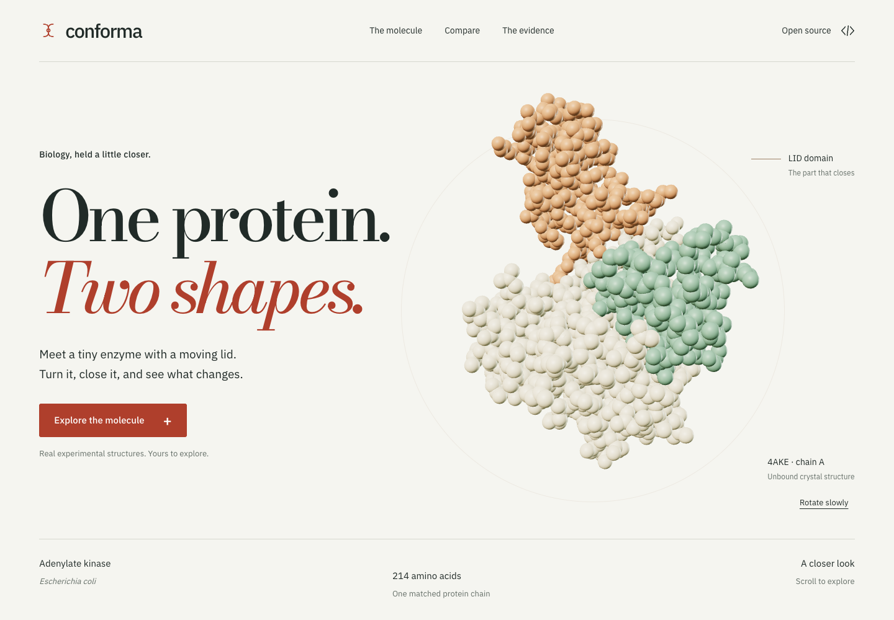
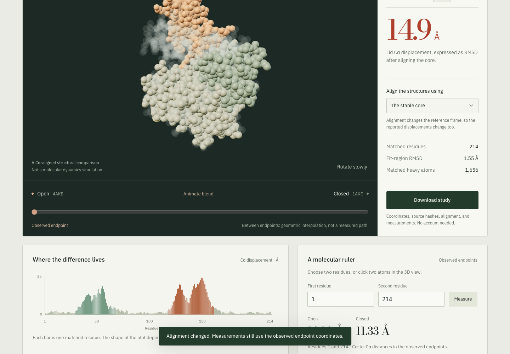

# Conforma

**One protein. Two shapes.**

[](https://rp-conforma.vercel.app)

**[Open the experience](https://rp-conforma.vercel.app)** · **[Methods & credits](https://rp-conforma.vercel.app/methods.html)** · **[Download & run locally](https://rp-conforma.vercel.app/conforma-source.zip)**

Conforma makes a structural comparison tangible. Turn a real protein, move between two experimental snapshots, follow a moving domain, and measure the difference. It combines a custom WebGL molecular renderer with a small, independently checked scientific engine.

The subject is *E. coli* adenylate kinase. [4AKE](https://www.rcsb.org/structure/4AKE) captures an unbound structure; [1AKE](https://www.rcsb.org/structure/1AKE) contains the substrate-mimicking inhibitor AP5A. These are published experimental structures, not generated protein models.



## What you can do

- Rotate **1,656 common heavy atoms** or switch to a smooth Cα backbone view.
- Inspect both observed endpoints and a clearly labeled illustrative geometric blend.
- Highlight the core, NMP region or lid; compare their Cα displacements after alignment.
- Switch between core-only and whole-chain fitting to see alignment sensitivity.
- Select residues in 3D or enter their numbers to measure endpoint distances.
- Export a labeled PNG or a full study JSON with matched coordinates, source hashes, fit settings and measurements.
- Keep using endpoint analysis when WebGL is unavailable; the fallback clearly identifies its static open-state projection.

The visual direction is an editorial specimen gallery: original identity, self-hosted typography, restrained color, and a real molecular form as the cover. There are no external runtime scripts, tracking SDKs, user accounts, paid AI APIs, or generated molecular stock images. See [the design notes](docs/design.md).

## Run locally

Node.js 22+:

```sh
npm ci
npm run build
npm start
# http://127.0.0.1:4472
```

The download includes the built `public/` site. To use it without installing packages, run `node server.mjs`. The server binds to loopback and serves only static files; there is no hosted analysis API. The scientific module and CLI use only Node built-ins.

```sh
node cli.mjs compare --fit core --out report.json
node cli.mjs compare --fit all --out whole-chain.json
node cli.mjs measure 55 150
```

## Reuse the scientific engine

```js
import {readFile} from 'node:fs/promises';
import {parsePDB, compareStructures, measurePair} from './src/science.mjs';

const open = parsePDB(await readFile('public/data/4AKE.pdb', 'utf8'));
const closed = parsePDB(await readFile('public/data/1AKE.pdb', 'utf8'));
const report = compareStructures(open, closed, {fit: 'core'});
console.log(report.fit_rmsd, report.domains.LID.rmsd);
console.log(measurePair(report, 55, 150));
```

## Method and reproducibility

A Horn quaternion fit rigidly aligns the closed structure to the open structure, using either 133 core Cα atoms or all 214 matched Cα atoms. A Jacobi eigensolver finds the optimal proper rotation. Atom correspondence requires identical residue numbers, insertion codes, atom names, and residue identities; there is no general sequence alignment or invented completion of missing atoms.

The declared [domain convention](https://doi.org/10.1371/journal.pcbi.1003938) is CORE 1–29, 68–117, 161–214; NMP 30–67; LID 118–160. Other literature uses different boundaries. Domain RMSD is measured after the selected reference fit, not independently minimized for each domain.

With the bundled records, core-fit RMSD is **1.5508 Å**, all-chain Cα RMSD after that core fit is **8.0940 Å**, and lid-domain RMSD is **14.8687 Å**. Whole-chain fitting gives **7.1307 Å** for its own fit. The ruler between residues 55 and 150 reports **43.6249 Å** open and **30.9013 Å** closed. Units and conventions belong with these values.

Raw PDB files, retrieval timestamps, source URLs and SHA-256 hashes are bundled. `npm run data` refreshes them from RCSB and regenerates the reference comparison; review the changed hashes and rerun checks before publishing refreshed data. This is a pinned snapshot, not a live structural-data service.

## Checks actually executed

- `npm test`: source-file hashes and derived-coordinate agreement, known rigid transforms, proper rotations versus reflection, sparse/malformed coordinates, domain counts, correspondence exclusions, interpolation bounds and fit-invariant internal distances.
- An independent **NumPy SVD** implementation checked both real-structure fits and **30 seeded rigid transforms**. Maximum coordinate differences in those fixtures were below 10⁻⁸ Å. [Recorded results](docs/numpy-comparison.json).
- Browser workflow results, environments and limits are recorded in [docs/browser-results.json](docs/browser-results.json). Software WebGL and emulated phone checks are not physical-device validation.

Optional independent validation:

```sh
python3 -m venv .validation-env
.validation-env/bin/pip install -r scripts/requirements-validation.txt
.validation-env/bin/python scripts/compare-numpy.py
```

Browser development checks require a running preview and the test browser:

```sh
npx playwright install chromium
node tests/browser.mjs
# CONFORMA_URL can select a deployment.
# CONFORMA_BROWSER can select an installed Chromium executable.
```

## Important interpretation limits

The slider linearly interpolates geometry. Intermediate frames are **not** a measured motion, a valid molecular-dynamics trajectory, a reaction mechanism, or a time-resolved experiment. No energy, force, rate or binding affinity is computed. Atomic bead sizes and colors are display choices, not a solvent-accessible surface. Water, ligands and unmatched atoms are omitted from the displayed model.

This is a curated comparison, not a replacement for Mol*, NGL, PyMOL, general structure alignment, structural validation, or molecular dynamics. Differences can reflect ligand state, crystal environment and experimental uncertainty. No worldwide novelty, clinical use, mechanistic discovery, or award is claimed.

## Project map

- `src/science.mjs` — zero-dependency parser, Horn fit, correspondence, RMSD, interpolation and ruler.
- `src/viewer.mjs` — custom instanced WebGL atomic display, backbone, overlay, picking and lifecycle handling.
- `src/app.mjs` — comparison controls, analysis displays and reproducible exports.
- `scripts/prepare-data.mjs` — fixed-source RCSB retrieval and provenance.
- `scripts/compare-numpy.py` — independent optional SVD checks.
- `public/` — self-contained built website, fonts and source coordinates.
- `tests/` — engine and browser verification.

MIT software by Rishit Pradhan. Structural data: original depositors and RCSB PDB / wwPDB; see [source records](public/data/structures.json). Font licenses are bundled. Design references and verification limits are documented rather than presented as endorsements.
